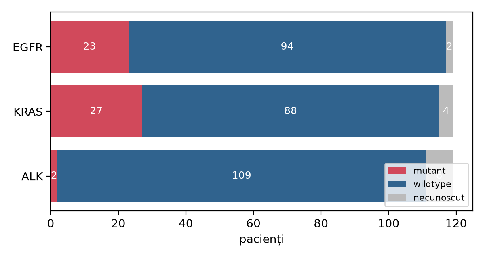
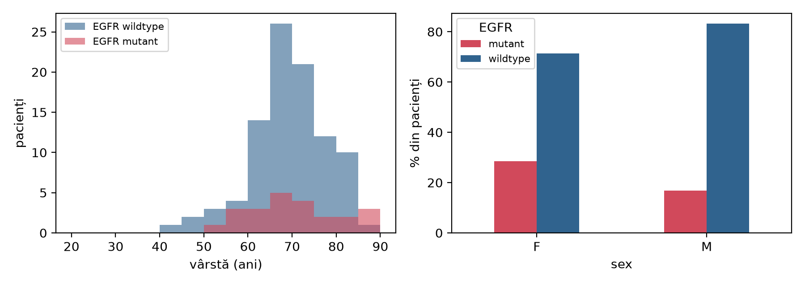
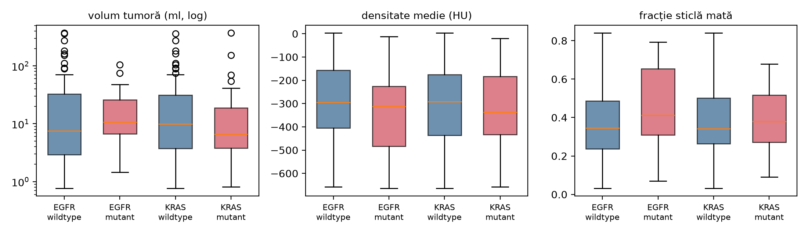
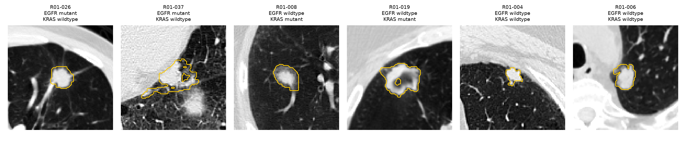
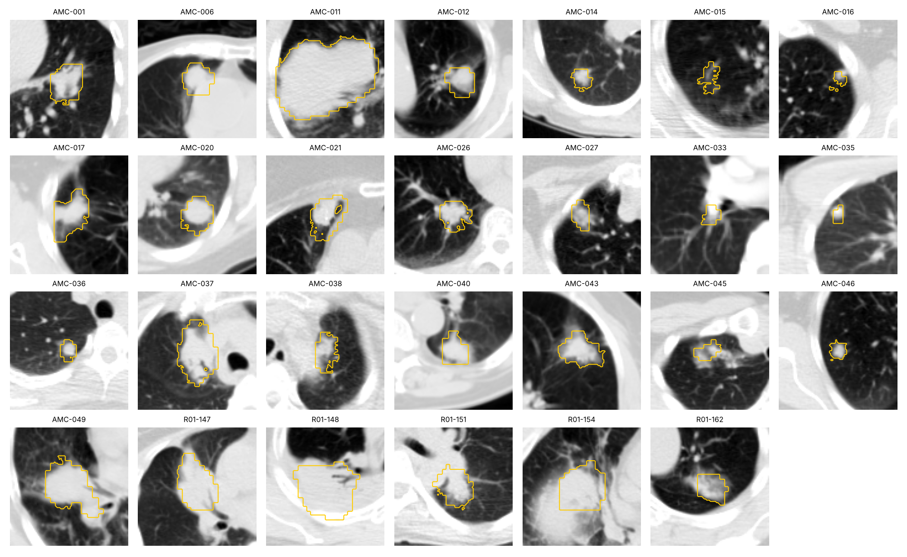
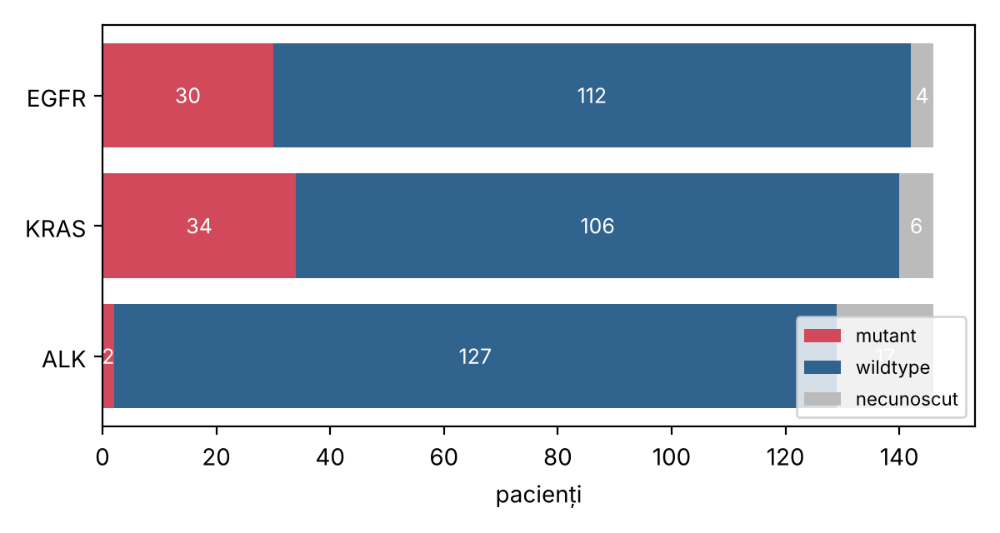
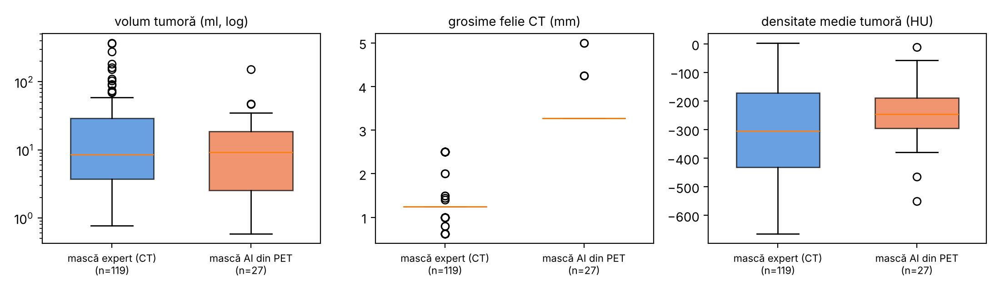
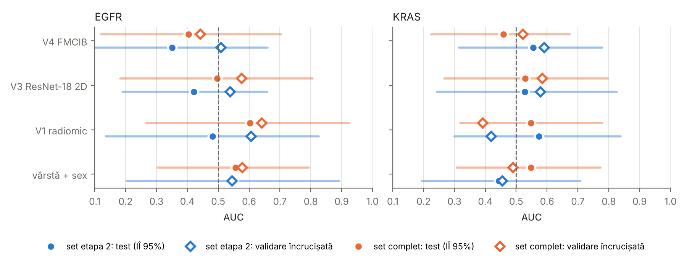
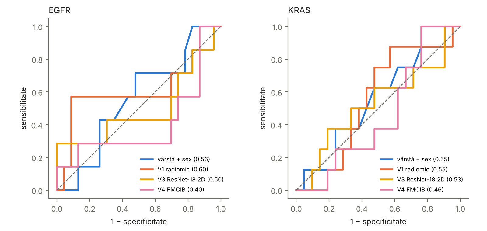
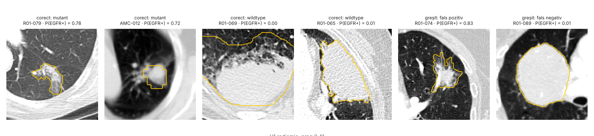

# Identificarea cancerului de plămân – „Biopsie virtuală” cu AI

**Raport proiect MIRPR** · Universitatea Babeș-Bolyai, Facultatea de Matematică și Informatică, Cluj-Napoca

**Membrii echipei:** Chertes Victor, Ionuț Constantin Ciocan, Răzvan Romulus Costea

> Variantă Markdown a raportului `documentation/Raport.tex` (sursa oficială este LaTeX).

# Introducere

## Ideea de bază a proiectului

Proiectul dezvoltă un sistem inteligent care analizează scanări CT pulmonare (eventual PET) și, împreună cu date clinice simple (vârstă, sex), prezice biomarkeri tumorali. Practic, este o „biopsie virtuală”: un instrument non-invaziv care sprijină radiologul în diagnosticarea timpurie a cancerului de plămân.

## Motivație

- Cancerul pulmonar este cel mai mortal tip de cancer la nivel mondial. Prognosticul depinde puternic de stadiul la care e detectat: în stadii incipiente supraviețuirea la 5 ani este mult mai mare decât în stadii avansate.

- Biopsia este invazivă, costisitoare, durează zile până la rezultatul IHC/genomic și nu poate fi repetată ușor. Unii pacienți nu o pot face din cauza localizării tumorii sau a stării generale.

- Un examen CT conține sute de felii pe pacient, iar radiologii trebuie să le interpreteze sub presiune de timp. Noduli mici și subtili pot fi omiși, iar între radiologi există variabilitate inter-observator.

- Relațiile dintre aspectul imagistic (textură, formă, densitate) și profilul molecular al tumorii sunt prea complexe și subtile pentru a fi evaluate vizual sau cu reguli scrise de mână. Deep learning-ul poate învăța automat aceste tipare (radiomics/radiogenomics).

- Un algoritm inteligent oferă consistență, viteză și o a doua opinie, reducând povara medicilor fără a-i înlocui.

## Funcționalitățile de bază ale aplicației

1.  **Încărcare date pacient:** upload fișier CT (NIfTI/DICOM) sau selectarea unui caz demo.

2.  **Introducere date clinice:** vârstă și sex.

3.  **Vizualizare CT:** navigare prin felii (axial/coronal/sagital) și suprapunerea măștii de segmentare.

4.  **Buton „Rulează analiza”:** apelează modulul AI. Momentan returnează o predicție hard-codată (ex. EGFR: 0.82, ALK: 0.12, KRAS: 0.35, PD-L1: 0.67). Interfața este definită astfel încât ulterior funcția predict() să fie înlocuită cu modelul real, fără alte modificări.

5.  **Afișarea rezultatelor:** tabel/bare cu probabilitatea pentru fiecare biomarker, cu indicator pozitiv/negativ după prag și avertisment că rezultatul este orientativ.

6.  **Export raport:** PDF/JSON cu datele pacientului, imaginea și predicțiile.

7.  **Istoric cazuri** (opțional): lista analizelor anterioare.

# Problema științifică abordată

## Descrierea problemei științifice

Imaginează-ți că un pacient face un CT toracic. Radiologul vede o masă suspectă, dar nu știe ce tip de tumoră este și ce markeri exprimă, informație care ar decide tratamentul (chimioterapie, imunoterapie, terapie țintită). Normal, ar trebui să aștepte o biopsie. Sistemul nostru „se uită” la imaginea CT, la segmentarea tumorii, la vârstă și sex și spune: „această tumoare probabil exprimă markerii X și Y, cu probabilitățile …”. Medicul primește un indiciu rapid, înainte sau în locul biopsiei.

- Tip de problemă: clasificare multi-label (un pacient poate avea simultan mai mulți biomarkeri pozitivi, deci etichetele nu se exclud reciproc).

- Intrare: x = (V, a, g), unde V este volumul CT 3D segmentat (tumoarea/regiunea de interes), a este vârsta, g este sexul.

- Ieșire: vectorul ŷ $\in$ $[0,1]^K$, unde K este numărul de biomarkeri și $\hat{y}_k$ este probabilitatea ca biomarkerul k să fie pozitiv.

- Adevărul de teren (ground truth): y $\in \{0,1\}^K$, obținut din biopsie confirmată (IHC, eventual genomic).

- Obiectiv: învățarea unei funcții $f_\theta: (V, a, g) \to \hat{y}$ care minimizează o pierdere de tip binary cross-entropy sumată pe cele K etichete:

- L = -$\frac{1}{K}$ $\sum_{k}$ $\left[ y_k \log \hat{y}_k + (1-y_k) \log(1-\hat{y}_k) \right]$

- Decizia finală: $\hat{y}_k \geq \widehat{\text{prag}}_k \implies \text{biomarker pozitiv}$ (pragul se poate calibra per etichetă).

## Utilizatori

- Radiologi (utilizatori principali): suport pentru diagnostic.

- Oncologi și pneumologi: orientarea planului de tratament.

- Patologi: prioritizarea cazurilor/probelor.

- Cercetători medicali.

## Tipuri de date

|                     | **Tip de date**       | **Format uzual**   | **Rol**           |
|:--------------------|:----------------------|:-------------------|:------------------|
| **Intrare**         | CT 3D (eventual PET)  | DICOM / NIfTI      | Imagistică        |
|                     | segmentat             | (.nii.gz)          | principală        |
| **Intrare**         | Vârstă                | Numeric            | Variabilă clinică |
| **Intrare**         | Sex                   | Categorial (binar) | Variabilă clinică |
| **Ieșire/etichete** | Markeri IHC (eventual | Binar per marker   | Ținta predicției  |
|                     | genomici)             | (0/1)              |                   |

Tabel date

## Măsurarea performanței

Pentru multi-label se raportează atât metrici per etichetă, cât și medii:

- AUC-ROC per marker și medie (macro): metrica principală, robustă la dezechilibru de clase.

- Sensibilitate (recall) și specificitate: critice în context medical (să nu ratezi un caz pozitiv).

- Precizie, F1-score (macro/micro).

- Hamming loss și subset accuracy: calitatea predicției pe setul întreg de etichete.

- Curbe de calibrare / Brier score: cât de fiabile sunt probabilitățile.

- Validare: split pe pacient (nu pe felii, pentru a evita scurgerea de date), cross-validation stratificată, set de test separat.

- Comparație cu baseline: regresie logistică pe doar vârstă+sex, iar apoi CNN 3D. Câștigul arată valoarea imaginii.

## Abstract grafic

<figure id="fig:abstract_grafic">

<figcaption>Diagrama fluxului aplicației</figcaption>
</figure>

# Metode existente de rezolvare a problemei (related work)

Această secțiune detaliază 6 abordări relevante din literatura de specialitate care tratează detecția cancerului pulmonar, predicția biomarkerilor și integrarea multi-modală\[cite: 1\].

## 1. Weakly Supervised Pathology-Informed Representation Learning (Virtual Biopsy)

Această lucrare este fundamentală pentru conceptul de "biopsie virtuală", demonstrând cum informațiile celulare microscopice pot fi deduse din imagini radiologice macroscopice\[cite: 1\].

- **Datele pe care s-a lucrat:** Studiul a utilizat seturi de date pereche constând în scanări radiologice non-invazive (CT și PET 3D) și imagini histopatologice de înaltă rezoluție (lamele colorate H&E) obținute din biopsii fizice. Datele au necesitat co-înregistrare spațială pentru a alinia regiunile tumorale de pe CT cu probele de țesut extrase.

- **Algoritmul cu care s-a lucrat:** S-a utilizat o arhitectură de tip Teacher-Student bazată pe Vision Transformers (ViT) și Knowledge Distillation. Rețeaua "Teacher" a fost antrenată să extragă trăsături complexe din histopatologie. Rețeaua "Student" a fost antrenată exclusiv pe imagini CT/PET, având ca funcție de loss minimizarea diferenței dintre reprezentările sale și cele ale rețelei Teacher. Astfel, modelul a învățat prin supervizare slabă să prezică micro-structuri patologice folosind doar imagini radiologice.

- **Rezultatele obținute:** Modelul a depășit semnificativ abordările standard (bazate doar pe CT) în predicția subtipurilor tumorale. S-au observat creșteri importante pe metricile de Mean Average Precision (mAP) și Normalized Discounted Cumulative Gain (NDCG), demonstrând capacitatea sa de a capta eterogenitatea intra-tumorală la nivel de voxel.

- **Librării și Git:** Python, ecosistemul PyTorch, ‘torchvision‘ (pentru augmentări) și biblioteci specifice pentru procesarea imaginilor histopatologice (ex. ‘OpenSlide‘). Git: <https://github.com/rajat-mae/virtual-biopsy-cbmir>.

## 2. Enhanced Lung Cancer Survival Prediction Using Semi-Supervised Learning

Un studiu excelent care evidențiază integrarea variabilelor heterogene (CT combinat cu date clinice precum vârsta și genul), așa cum este necesar în scopul acestui proiect\[cite: 1\].

- **Datele pe care s-a lucrat:** Abordarea a folosit scanări CT și PET specifice cancerului pulmonar, alături de date clinice (Vârstă, Gen, Stadiul tumorii). Pentru a profita de paradigma semi-supervizată, s-au folosit volume masive de date radiologice neetichetate (extrase din baze de date publice precum TCIA) împreună cu datele etichetate ale pacienților.

- **Algoritmul cu care s-a lucrat:** Procesul a început cu extragerea trăsăturilor radiomice 3D (textură, formă, intensitate). Din cauza dimensionalității ridicate, s-au aplicat tehnici de reducere a dimensionalității prin 3D-Autoencoders (Deep Learning nesupervizat) și Principal Component Analysis (PCA). Ulterior, s-au antrenat algoritmi clasici (Random Forest, K-Nearest Neighbors, Multi-Layer Perceptron) folosind paradigme de Semi-Supervised Learning (ex. pseudo-labeling).

- **Rezultatele obținute:** Prin integrarea datelor neetichetate și a markerilor clinici, acuratețea medie a predicției de supraviețuire (Overall Survival) a crescut de la un baseline de $\sim 70\%$ (în modelele strict supervizate) la peste $85\%$. Metrica C-index a înregistrat de asemenea o îmbunătățire stabilă.

- **Librării și Git:** Python, ‘PySERA‘ (pentru extragerea trăsăturilor radiomice 3D), ‘Scikit-Learn‘ (pentru ML clasic și PCA) și ‘Keras‘/‘PyTorch‘ pentru Autoencodere. Git: <https://github.com/MohammadRSalmanpour/Semi-Supervised-approach-for-servival-prediction-in-Lung-cancer->.

## 3. Multichannel Deep Learning Prediction of Major Pathological Response

Foarte relevant pentru sarcina de "biopsie virtuală", acest studiu folosește AI pentru a prezice patologia celulară pre-tratament strict din imagistica macroscopică pre-tratament\[cite: 1\].

- **Datele pe care s-a lucrat:** Scanări CT pre-tratament (fără și cu substanță de contrast) și fișe clinice de la 332 de pacienți cu NSCLC (Non-Small Cell Lung Cancer). Datele au fost multi-centrice pentru a preveni supra-adaptarea la un singur tip de scaner. Imaginile au fost decupate precis în jurul Regiunii de Interes 3D (tumora propriu-zisă).

- **Algoritmul cu care s-a lucrat:** O arhitectură hibridă complexă denumită "Transformer_GoogLeNet". Aceasta utilizează module Inception (din GoogLeNet) ca rețea convoluțională pentru a extrage trăsături spațiale locale din patch-urile CT. Aceste trăsături sunt apoi trecute printr-un modul Transformer, care folosește mecanisme de self-attention pentru a înțelege contextul global și relațiile spațiale complexe din interiorul și din jurul tumorii, pe mai multe felii 2D simultan (multi-canal).

- **Rezultatele obținute:** Modelul hibrid a atins o arie sub curba ROC (AUC) remarcabilă de $0.924$, validând cu succes dacă pacientul va avea un Răspuns Patologic Major (MPR). Modelul a surclasat atât modelele radiomice clasice, cât și CNN-urile standard (precum ResNet sau VGG).

- **Librării și Git:** Python, ‘PyTorch‘ (pentru hibridul personalizat GoogLeNet + Transformer), ‘Pydicom‘ (citirea metadatelor) și ‘SimpleITK‘ pentru procesarea imaginilor medicale. Nu există un repozitoriu Git public asociat direct cu articolul publicat în PMC.

## 4. Lung Nodule Detection using YOLO pe LIDC-IDRI

Un exemplu practic de procesare a setului principal de date cerut în proiect (LIDC-IDRI), tratând problema ca o sarcină de Detecție de Obiecte adaptată pentru contextul medical\[cite: 1\].

- **Datele pe care s-a lucrat:** Baza de date oficială LIDC-IDRI, constând în imagini CT toracice salvate în format DICOM. Setul de date include adnotări XML create de radiologi experți (contururi și coordonate bounding-box pentru noduli cu dimensiuni cuprinse între 3 mm și $>30$ mm). Modelul a operat pe felii 2D extrase din volumele 3D.

- **Algoritmul cu care s-a lucrat:** Algoritmul YOLO (You Only Look Once) a fost implementat cu un backbone personalizat. Deoarece nodulii pulmonari pot fi extrem de mici, rețeaua a integrat concepte din U-Net și ResNet. Conexiunile de tip skip (skip connections) inspirate din U-Net au ajutat la păstrarea informațiilor spațiale de înaltă rezoluție, asigurând că nodulii mici nu se pierd în straturile adânci.

- **Rezultatele obținute:** Modelul a obținut un baseline solid de detecție, cu o acuratețe generală de aproximativ $65\%$ pe setul de test. Avantajul major demonstrat a fost viteza de inferență (procesare a feliilor aproape în timp real) și un echilibru puternic între Precizie (evitarea alarmelor false) și Recall (minimizarea nodulilor maligni ratați).

- **Librării și Git:** Python, ‘TensorFlow 2.x / Keras‘ (pentru construirea arhitecturii), ‘pydicom‘ (extragerea matricei de pixeli), ‘NumPy‘ și ‘OpenCV‘. Git: <https://github.com/suhailashakiah/LungNoduleDetection>.

## 5. Hierarchical Vision Transformer cu Prototypes pentru LIDC-IDRI

O abordare de ultimă generație care tratează analiza nodulilor ca pe o problemă "multi-label ordinală", excelentă pentru profilarea biomarkerilor tumorali specifici\[cite: 1\].

- **Datele pe care s-a lucrat:** Setul complet LIDC-IDRI 3D CT, concentrându-se profund pe adnotările semantice multi-label furnizate de medici: gradul de malignitate (pe o scară de la 1 la 5), spicularea, calcifierea și subtilitatea. Patch-urile 3D au fost decupate exact în jurul zonelor nodulare confirmate.

- **Algoritmul cu care s-a lucrat:** Un Hierarchical Vision Transformer (ViT). Deoarece o malignitate de nivel 5 este mai severă decât nivelul 4 (relație ordinală), a fost implementată o funcție de loss ordinală personalizată. Inovația principală a fost arhitectura de "Prototype Reasoning": rețeaua învață "prototipuri" virtuale (ex. "cum arată cel mai clar nodul de gradul 3"). La evaluarea unui pacient nou, modelul clasifică tumora calculând distanța matematică dintre trăsăturile pacientului și prototipurile învățate, oferind astfel interpretabilitate.

- **Rezultatele obținute:** Arhitectura a obținut rezultate State-of-the-Art pe setul LIDC pentru metrica Within-1-Accuracy (procentul în care modelul a ghicit exact scorul medicului sau a deviat cu maxim 1 punct, ceea ce este acceptabil în practica clinică). AUC-ul pentru clasificarea binară (benign vs. malign) a depășit $0.90$.

- **Librării și Git:** Python, ‘PyTorch‘, ecosistemul ‘MONAI‘ (Medical Open Network for AI), ‘scikit-image‘ și instrumente de generare a hărților de atenție. Git reprezentativ: <https://github.com/huzisheng/LIDC-IDRI-Vision-Transformer>.

## 6. Lung Cancer Detection using Segmentation and CNN (LUNA16)

Această lucrare descrie perfect etapele tehnice preliminare: cum să transformi un CT brut într-o imagine pulmonară curată, segmentată (scanări 3D segmentate), înainte de predicția markerilor\[cite: 1\].

- **Datele pe care s-a lucrat:** Setul de date public LUNA16, care este un subset rafinat și standardizat din LIDC-IDRI. Acesta exclude scanările cu o grosime a secțiunii mai mare de 2.5 mm, asigurând un set de date omogen, de înaltă rezoluție. Adnotările constau în coordonate 3D precise ale centrelor nodulilor.

- **Algoritmul cu care s-a lucrat:** Un pipeline în doi pași. Pasul 1 (Segmentare 3D): S-au folosit tehnici clasice de Computer Vision (algoritmi morfologici și Watershed) pentru a separa parenchimul pulmonar de structurile irelevante (oase, patul pacientului, aer exterior). Pasul 2 (Clasificare): Patch-urile pulmonare extrase au fost introduse într-o rețea convoluțională VGG-16. Prin Transfer Learning, rețeaua (pre-antrenată pe ImageNet) a fost ajustată (fine-tuned) în straturile finale pentru a învăța texturile specifice cancerului.

- **Rezultatele obținute:** Segmentarea inițială a obținut o izolare precisă a plămânilor cu un zgomot de fond minim. CNN-ul VGG16 a extras eficient caracteristicile vizuale esențiale, atingând un nivel ridicat de Sensibilitate (capacitatea de a minimiza Falsele Negative, aspect critic în screening-ul cancerului).

- **Librării și Git:** Python, ‘OpenCV‘ (pentru segmentarea Watershed), ‘Keras‘ / ‘TensorFlow‘ și ‘pydicom‘. Git: <https://github.com/dv-123/Lung_cancer>.

# Metode efectiv folosite pentru rezolvarea problemei

## Prezentare generală

Problema este tratată ca o clasificare binară pentru fiecare biomarker (EGFR mutant/wildtype, KRAS mutant/wildtype), pornind de la volumul CT al tumorii, masca de segmentare a tumorii, vârsta și sexul pacientului. ALK nu a fost inclus în antrenare deoarece setul de date conține doar 2 pacienți cu translocație ALK, insuficient pentru a învăța sau a evalua un clasificator.

Toate cele trei variante folosesc aceeași preprocesare, implementată în `software-solution/ml/prepare_dataset.py`:

1.  seria CT (DICOM) și segmentarea expertului (DICOM SEG) sunt citite cu `SimpleITK` și `pydicom`, iar masca este rasterizată pe grila CT folosind poziția fiecărei felii;

2.  volumul și masca sunt reeșantionate la voxeli izotropi de 1 mm (interpolare liniară pentru CT, nearest neighbour pentru mască), pentru a elimina diferențele de rezoluție dintre scanere (grosimea feliei variază între 0.625 și 2.5 mm);

3.  se decupează un cub de $96 \times 96 \times 96$ mm centrat pe centrul de masă al tumorii și se salvează în format NIfTI (`.nii.gz`), același format acceptat de aplicație.

Cele trei variante diferă prin modul în care transformă imaginea în trăsături: trăsături calculate manual (varianta 1), trăsături învățate de la zero de o rețea 3D (varianta 2) și trăsături preluate dintr-o rețea pre-antrenată pe imagini naturale (varianta 3). Scopul este compararea celor trei abordări pe același set mic de date.

## Varianta 1: trăsături radiomice simple și regresie logistică

**Algoritmul.** Pentru fiecare tumoră se calculează 7 trăsături interpretabile din cubul CT și masca expertului:

- formă și dimensiune: volumul tumorii (ml), diametrul maxim (mm), compactitatea (raportul volum/suprafață);

- densitate: media și deviația standard a valorilor Hounsfield (HU) din tumoră;

- compoziție: fracția de componentă solidă (HU $> -300$) și fracția de sticlă mată (ground-glass, $-800 <$ HU $\le -300$).

La acestea se adaugă vârsta și sexul. Trăsăturile sunt standardizate (medie 0, deviație 1) și introduse într-o regresie logistică cu regularizare L2, câte un model separat pentru fiecare biomarker $k$: $$\hat{y}_k = \sigma\left(w_k^\top x + b_k\right), \qquad \min_{w_k, b_k} \; -\sum_i c_{y_i}\left[y_i \log \hat{y}_i + (1-y_i)\log(1-\hat{y}_i)\right] + \frac{1}{2C}\lVert w_k \rVert^2,$$ unde $c_{y}$ sunt ponderile de clasă (`class_weight="balanced"`) care compensează dezechilibrul mutant/wildtype.

**Motivație.** Cu aproximativ 95 de pacienți de antrenare, un model cu 10 parametri este cel mai puțin expus supra-învățării. Literatura de radiogenomică arată că mutațiile EGFR apar mai des în tumori cu componentă de sticlă mată, iar coeficienții regresiei logistice pot fi citiți direct de un medic.

**Librării.** `SimpleITK` (citire NIfTI), `NumPy`, `SciPy` (eroziune morfologică pentru suprafață), `scikit-learn` (`StandardScaler`, `LogisticRegression`). Implementare: `software-solution/ml/variant1_features.py`.

## Varianta 2: rețea neuronală convoluțională 3D antrenată de la zero

**Algoritmul.** Intrarea rețelei este cubul central de $64 \times 64 \times 64$ voxeli (64 mm la rezoluția de 1 mm) cu două canale: CT-ul normalizat în $[0,1]$ din intervalul $[-1000, 400]$ HU și masca binară a tumorii. Arhitectura conține trei blocuri *Conv3D $3\times3\times3$ – BatchNorm – ReLU – MaxPool $2\times2\times2$* cu 8, 16 și 32 de filtre, urmate de un global average pooling care produce un vector de 32 de trăsături. Acest vector este concatenat cu vârsta (standardizată) și sexul, apoi trece printr-un strat Dropout (0.5) și un strat liniar cu 2 ieșiri, câte una pentru EGFR și KRAS (clasificare multi-label cu ieșiri sigmoid).

Funcția de pierdere este binary cross-entropy mascată: dacă un pacient are o etichetă necunoscută (de ex. KRAS nedeterminat), termenul respectiv este exclus, astfel încât pacientul contribuie în continuare prin eticheta cunoscută. Clasa pozitivă este ponderată cu raportul negative/pozitive din setul de antrenare (`pos_weight`).

**Augmentare.** La fiecare pas, volumul este întors aleator pe două axe (flip) și rotit cu un multiplu de $90^\circ$ în planul axial. Aceste transformări nu schimbă biologia tumorii, dar măresc artificial varietatea exemplelor.

**Motivație.** Modelul învață direct din voxeli, fără a presupune ce trăsături contează, și vede întreaga formă 3D a tumorii și țesutul din jur. Rețeaua este intenționat mică (aproximativ 18 mii de parametri) pentru a putea fi antrenată pe CPU și pe un set mic de date; ea este punctul de plecare pentru îmbunătățirile din etapele următoare (pre-antrenare, mai multe date).

**Librării.** `PyTorch` (model, antrenare, optimizator Adam), `SimpleITK`, `NumPy`, `scikit-learn` (împărțirea datelor și metrici). Implementare: `software-solution/ml/variant2_cnn3d.py`.

## Varianta 3: transfer learning cu ResNet-18 pre-antrenat pe ImageNet

**Algoritmul.** Din cubul fiecărui pacient se alege felia axială cu cea mai mare arie a tumorii. Felia este transformată într-o imagine RGB în care fiecare canal reprezintă o vizualizare folosită de radiolog: fereastra pulmonară ($[-1350, 150]$ HU), fereastra de țesut moale/mediastin ($[-160, 240]$ HU) și masca tumorii. Imaginea este redimensionată la $224 \times 224$ și normalizată cu media și deviația ImageNet.

Rețeaua ResNet-18 \[6\], cu ponderile pre-antrenate pe ImageNet (`IMAGENET1K_V1`), este folosită fără re-antrenare, ca extractor de trăsături: ultimul strat de clasificare este eliminat, iar ieșirea global average pooling oferă 512 trăsături per pacient. Acestea, împreună cu vârsta și sexul, sunt standardizate, reduse la 16 componente prin PCA și clasificate cu regresie logistică L2 cu ponderi de clasă echilibrate, câte un model pentru fiecare biomarker.

**Motivație.** Transfer learning-ul este abordarea standard când datele etichetate sunt puține: filtrele învățate pe 1.2 milioane de imagini naturale detectează margini, texturi și forme generale, utile și pe imagini medicale. Înghețarea completă a rețelei și reducerea PCA păstrează numărul de parametri antrenabili mic (17 per biomarker).

**Librării.** `PyTorch` și `torchvision` (ResNet-18 pre-antrenat), `scikit-learn` (`PCA`, `LogisticRegression`), `SimpleITK`. Implementare: `software-solution/ml/variant3_resnet.py`.

# Rezultate experimentale obținute

## Descrierea seturilor de date folosite

### Sursa datelor

Am folosit setul public **NSCLC Radiogenomics** \[3\], publicat pe The Cancer Imaging Archive (TCIA) \[4\] și accesibil programatic prin NCI Imaging Data Commons \[5\]. Este singurul set public identificat care conține, pentru aceiași pacienți, imagini CT toracice, segmentări ale tumorii și statusul mutațiilor EGFR, KRAS și ALK, adică exact intrările și ieșirile problemei noastre. Nu am găsit niciun set public de CT cu etichete PD-L1; studiile care prezic PD-L1 folosesc date private, motiv pentru care PD-L1 nu este inclus în antrenare.

### Modul de colectare

Datele au fost colectate retrospectiv de Stanford University School of Medicine și Palo Alto Veterans Affairs Healthcare System, de la pacienți cu cancer pulmonar fără celule mici (NSCLC) operați între 2008 și 2012. Scanările CT au fost efectuate înainte de intervenția chirurgicală. Tumorile au fost segmentate semi-automat de radiologi (3D Slicer, ePAD), iar statusul mutațiilor a fost determinat pe țesutul tumoral excizat chirurgical: EGFR pe exonii 18–21, KRAS prin testare mutațională, ALK prin detectarea translocației EML4-ALK. Datele clinice (vârstă, sex, fumat, histologie, stadiu) provin din fișele medicale.

### Subsetul folosit (small data)

Colecția completă are 211 pacienți și aproximativ 98 GB. Am selectat doar pacienții care au simultan o segmentare a tumorii făcută de expert pe CT și statusul EGFR sau KRAS cunoscut, rezultând **119 pacienți** (în intervalul de 100–200 de exemple cerut). Pentru fiecare pacient s-au descărcat doar seria CT segmentată și segmentarea (aproximativ 17 GB în total), care au fost convertite și decupate ca în capitolul <a href="#chapter:metode_propuse" data-reference-type="ref" data-reference="chapter:metode_propuse">4</a>; datele finale ocupă 143 MB.

### Aspecte etice și legale

- **Anonimizare și GDPR:** datele au fost de-identificate de TCIA înainte de publicare (eliminarea numelor, datelor de naștere și identificatorilor din antetele DICOM, deplasarea datelor calendaristice). Datele anonimizate nu mai sunt date cu caracter personal în sensul GDPR (considerentul 26), deci prelucrarea lor nu necesită consimțământul pacienților. Nu am încercat re-identificarea pacienților și nu am combinat datele cu alte surse.

- **Aprobare etică:** colectarea originală a fost aprobată de comisiile de etică (IRB) ale instituțiilor participante, conform descrierii setului \[3\].

- **Licență și drepturi de autor:** imaginile, segmentările și datele clinice sunt publicate sub licența Creative Commons Attribution 3.0 (CC BY 3.0), care permite utilizarea, modificarea și redistribuirea cu condiția citării sursei. Am respectat politica de utilizare TCIA citând articolul de descriere a datelor \[3\] și arhiva \[4\].

- **Scop:** modelele sunt folosite exclusiv în scop educațional și de cercetare; rezultatele nu sunt destinate deciziilor clinice.

### Analiza exploratorie a datelor (EDA)

Analiza este generată de scriptul `software-solution/ml/eda.py`.

**Etichete.** Setul este puternic dezechilibrat (figura <a href="#fig:eda_etichete" data-reference-type="ref" data-reference="fig:eda_etichete">5.1</a>): EGFR este mutant la 23 din 117 pacienți cu status cunoscut (19.7%), KRAS la 27 din 115 (23.5%), iar ALK la doar 2 pacienți. Mutațiile EGFR și KRAS sunt aproape mutual exclusive (un singur pacient le are pe ambele), ceea ce corespunde biologiei cunoscute a NSCLC.

<figure id="fig:eda_etichete">

<figcaption>Distribuția etichetelor pe cei 119 pacienți</figcaption>
</figure>

**Date clinice.** Vârsta medie este 68.9 ani (deviație 8.8, interval 43–87); 91 de pacienți sunt bărbați și 28 femei. Histologia este predominant adenocarcinom (99), urmată de carcinom scuamos (17). Statusul de fumător și sexul sunt asociate puternic cu mutațiile:

- EGFR este mutant la 43.8% dintre nefumători, 18.2% dintre foștii fumători și doar 8.3% dintre fumătorii activi; la femei frecvența este 28.6%, față de 16.9% la bărbați (figura <a href="#fig:eda_clinic" data-reference-type="ref" data-reference="fig:eda_clinic">5.2</a>);

- KRAS urmează tiparul invers: 33.3% la fumătorii activi și 6.2% la nefumători;

- niciun carcinom scuamos nu are mutație EGFR sau KRAS.

Vârsta nu diferă între grupuri (mediana 68 ani pentru EGFR mutant față de 69 pentru wildtype). Statusul de fumător nu este folosit ca intrare, deoarece aplicația primește doar vârsta și sexul.

<figure id="fig:eda_clinic">

<figcaption>Vârsta pe status EGFR (stânga) și procentul de EGFR mutant pe sex (dreapta)</figcaption>
</figure>

**Imagini.** Tumorile variază foarte mult ca dimensiune: volumul median este 8.5 ml (interval 0.8–372 ml), deci un model trebuie să funcționeze atât pe noduli mici, cât și pe mase mari. Rezoluția originală diferă între scanări (grosime de felie 0.625–2.5 mm, majoritatea 1.25 mm; dimensiunea pixelului 0.59–0.98 mm), ceea ce justifică reeșantionarea la 1 mm. Diferențele dintre grupuri sunt mici (figura <a href="#fig:eda_tumora" data-reference-type="ref" data-reference="fig:eda_tumora">5.3</a>): tumorile EGFR mutante au o fracție de sticlă mată ușor mai mare (mediana 0.41 față de 0.35) și o densitate medie ușor mai mică ($-313$ față de $-294$ HU), iar tumorile KRAS mutante sunt ușor mai mici (6.6 față de 9.9 ml). Suprapunerea mare a distribuțiilor arată că problema este dificilă. Figura <a href="#fig:eda_exemple" data-reference-type="ref" data-reference="fig:eda_exemple">5.4</a> prezintă exemple de felii cu conturul segmentării.

<figure id="fig:eda_tumora">

<figcaption>Volumul, densitatea medie și fracția de sticlă mată a tumorii, pe status EGFR și KRAS</figcaption>
</figure>

<figure id="fig:eda_exemple">

<figcaption>Felia axială cu cea mai mare arie a tumorii (contur galben = segmentarea expertului), fereastră pulmonară</figcaption>
</figure>

## Metodologia experimentală

### Întrebări experimentale

1.  Se poate prezice statusul EGFR și KRAS din CT, vârstă și sex peste nivelul întâmplător (AUC 0.5) cu doar aproximativ 100 de pacienți?

2.  Care dintre cele trei abordări (trăsături manuale, CNN 3D de la zero, transfer learning 2D) funcționează cel mai bine pe date puține?

### Împărțirea datelor

Împărțirea se face la nivel de pacient (toate datele unui pacient sunt într-un singur subset), stratificată după combinația statusurilor EGFR și KRAS, cu `random_state=42`. Toate cele trei variante folosesc **același set de test**, de 24 de pacienți (20%), fiecare biomarker având 6 pozitivi și 18 negativi în test.

- Variantele 1 și 3: 95 de pacienți de antrenare și 24 de test. Modelele liniare nu au nevoie de oprire timpurie, deci nu se folosește un set de validare separat.

- Varianta 2: din cei 95 de pacienți, 20% (19) sunt păstrați pentru validare, folosită la alegerea epocii; rămân 76 pentru antrenare.

Pacienții cu un status necunoscut sunt excluși doar pentru biomarkerul respectiv.

### Metrici

- **AUC-ROC** per biomarker, metrica principală, deoarece nu depinde de prag și este robustă la dezechilibrul de clase;

- **acuratețea**, **sensibilitatea** (proporția mutanților detectați) și **specificitatea** (proporția wildtype-urilor recunoscute), calculate la pragul 0.5;

- interval de încredere 95% pentru AUC prin bootstrap (2000 de re-eșantionări ale setului de test).

### Hiperparametri

| **Varianta**       | **Hiperparametru** | **Valoare**                                                      |
|:-------------------|:-------------------|:-----------------------------------------------------------------|
| 1\. Trăsături + LR | intrări            | 7 trăsături tumorale + vârstă + sex                              |
|                    | regularizare       | L2, $C = 0.5$                                                    |
|                    | ponderi de clasă   | echilibrate                                                      |
|                    | preprocesare       | standardizare                                                    |
| 2\. CNN 3D         | intrare            | $2 \times 64^3$ (CT + mască), 1 mm                               |
|                    | arhitectură        | 3 blocuri Conv3D (8/16/32 filtre) + GAP + liniar                 |
|                    | optimizator        | Adam, rată de învățare $3 \cdot 10^{-4}$, weight decay $10^{-3}$ |
|                    | epoci, batch       | 60, 8                                                            |
|                    | dropout            | 0.5                                                              |
|                    | loss               | BCE mascată, `pos_weight` = negative/pozitive                    |
|                    | augmentare         | flip pe 2 axe, rotație $k \cdot 90^\circ$                        |
|                    | selecție model     | epoca cu AUC macro maxim pe validare                             |
| 3\. ResNet-18      | backbone           | ResNet-18 ImageNet, înghețat                                     |
|                    | intrare            | felia cu aria maximă, $3 \times 224 \times 224$                  |
|                    | reducere           | PCA, 16 componente                                               |
|                    | clasificator       | LR L2, $C = 0.1$, ponderi echilibrate                            |

Hiperparametrii celor trei variante

## Rezultatele obținute

### Varianta 1: trăsături radiomice simple și regresie logistică

|      | **AUC** | **Acuratețe** | **Sensibilitate** | **Specificitate** |
|:-----|:-------:|:-------------:|:-----------------:|:-----------------:|
| EGFR |  0.722  |     0.667     |       0.50        |       0.72        |
| KRAS |  0.546  |     0.583     |       0.67        |       0.56        |

Varianta 1: rezultate pe setul de test (24 de pacienți)

Varianta 1 obține cel mai bun AUC pentru EGFR dintre cele trei variante. Coeficienții modelului EGFR arată că diametrul (+0.65), fracția de sticlă mată (+0.54) și vârsta (+0.26) cresc probabilitatea de mutație, în acord cu EDA. Pentru KRAS modelul este aproape de nivelul întâmplător.

| **Biomarker** | **Pacient** | **Real** | **Probabilitate** | **Prezis** | **Observație**           |
|:--------------|:------------|:--------:|:-----------------:|:----------:|:-------------------------|
| EGFR          | R01-127     |  mutant  |       0.75        |   mutant   | corect, nefumător        |
| EGFR          | R01-036     | wildtype |       0.08        |  wildtype  | corect, tumoră de 275 ml |
| EGFR          | R01-003     |  mutant  |       0.20        |  wildtype  | greșit, nodul de 1.5 ml  |
| EGFR          | R01-044     | wildtype |       0.73        |   mutant   | greșit                   |
| KRAS          | R01-097     |  mutant  |       0.62        |   mutant   | corect, fumător activ    |
| KRAS          | R01-113     | wildtype |       0.66        |   mutant   | greșit                   |

Varianta 1: exemple corect și greșit prezise

### Varianta 2: CNN 3D antrenat de la zero

|      | **AUC** | **Acuratețe** | **Sensibilitate** | **Specificitate** |
|:-----|:-------:|:-------------:|:-----------------:|:-----------------:|
| EGFR |  0.583  |     0.333     |       1.00        |       0.11        |
| KRAS |  0.611  |     0.708     |       0.50        |       0.78        |

Varianta 2: rezultate pe setul de test (24 de pacienți)

Cel mai bun AUC macro pe validare a fost atins în primele epoci, apoi a scăzut, semn că rețeaua începe să memoreze cei 76 de pacienți de antrenare. Probabilitățile prezise sunt concentrate în jurul valorii 0.5 (între 0.42 și 0.55), astfel că la pragul fix 0.5 aproape toți pacienții sunt clasificați EGFR mutant (sensibilitate 1.00, specificitate 0.11). Ordinea pacienților este totuși parțial corectă (AUC peste 0.5), iar pentru KRAS varianta 2 are cel mai bun AUC dintre cele trei.

| **Biomarker** | **Pacient** | **Real** | **Probabilitate** | **Prezis** | **Observație**           |
|:--------------|:------------|:--------:|:-----------------:|:----------:|:-------------------------|
| EGFR          | R01-098     |  mutant  |       0.52        |   mutant   | corect                   |
| EGFR          | R01-036     | wildtype |       0.48        |  wildtype  | corect, tumoră de 275 ml |
| EGFR          | R01-094     | wildtype |       0.53        |   mutant   | greșit                   |
| KRAS          | R01-094     |  mutant  |       0.55        |   mutant   | corect                   |
| KRAS          | R01-051     | wildtype |       0.45        |  wildtype  | corect, nefumător        |
| KRAS          | R01-029     |  mutant  |       0.42        |  wildtype  | greșit, tumoră de 152 ml |

Varianta 2: exemple corect și greșit prezise

### Varianta 3: transfer learning cu ResNet-18

|      | **AUC** | **Acuratețe** | **Sensibilitate** | **Specificitate** |
|:-----|:-------:|:-------------:|:-----------------:|:-----------------:|
| EGFR |  0.648  |     0.625     |       0.33        |       0.72        |
| KRAS |  0.491  |     0.708     |       0.33        |       0.83        |

Varianta 3: rezultate pe setul de test (24 de pacienți)

Trăsăturile ImageNet aduc un semnal moderat pentru EGFR, dar niciunul pentru KRAS. Varianta 3 este cea mai conservatoare (specificitate mare, sensibilitate mică), iar o singură felie 2D pierde informația despre forma 3D a tumorii.

| **Biomarker** | **Pacient** | **Real** | **Probabilitate** | **Prezis** | **Observație**                |
|:--------------|:------------|:--------:|:-----------------:|:----------:|:------------------------------|
| EGFR          | R01-132     |  mutant  |       0.79        |   mutant   | corect                        |
| EGFR          | R01-085     | wildtype |       0.07        |  wildtype  | corect                        |
| EGFR          | R01-127     |  mutant  |       0.23        |  wildtype  | greșit (corect în varianta 1) |
| KRAS          | R01-094     |  mutant  |       0.91        |   mutant   | corect                        |
| KRAS          | R01-097     |  mutant  |       0.03        |  wildtype  | greșit (corect în varianta 1) |
| KRAS          | R01-085     | wildtype |       0.74        |   mutant   | greșit                        |

Varianta 3: exemple corect și greșit prezise

### Comparație

| **Varianta**       | **AUC EGFR \[IC 95%\]** | **AUC KRAS \[IC 95%\]** |
|:-------------------|:-----------------------:|:-----------------------:|
| 1\. Trăsături + LR | **0.72** \[0.40, 0.97\] |   0.55 \[0.20, 0.86\]   |
| 2\. CNN 3D         |   0.58 \[0.34, 0.83\]   | **0.61** \[0.26, 0.94\] |
| 3\. ResNet-18      |   0.65 \[0.36, 0.91\]   |   0.49 \[0.12, 0.86\]   |

AUC pe setul de test, cu interval de încredere 95% (bootstrap)

Un caz greu este R01-003 (EGFR și KRAS mutant, nodul de doar 1.5 ml, fumător activ): este ratat pentru EGFR de variantele 1 și 3, deoarece profilul său (nodul mic, fumător) seamănă cu cel al tumorilor wildtype.

## Analiza statistică

Cu doar 6 pacienți pozitivi per biomarker în setul de test, schimbarea predicției pentru un singur pacient modifică AUC-ul cu câteva sutimi. Intervalele de încredere bootstrap (tabelul <a href="#tab:comparatie" data-reference-type="ref" data-reference="tab:comparatie">5.8</a>) sunt foarte largi și **toate includ valoarea 0.5**, deci niciuna dintre variante nu este statistic mai bună decât predicția întâmplătoare, iar diferențele dintre variante nu sunt semnificative. Ordinea observată (varianta 1 cea mai bună pentru EGFR, varianta 2 pentru KRAS) trebuie tratată ca orientativă.

Rezultatele sunt totuși consistente cu EDA: semnalul cel mai clar pentru EGFR vine din compoziția tumorii (sticlă mată) și dimensiune, pe care varianta 1 le primește direct, în timp ce modelele care trebuie să învețe singure aceste trăsături (variantele 2 și 3) nu au suficiente exemple. Pentru evaluări mai fiabile, etapele următoare vor folosi validare încrucișată repetată pe toți cei 119 pacienți în locul unui singur set de test.

# Algoritm inteligent pe date reale (etapa 3)

În această etapă am reluat experimentele din etapa 2 pe setul real **NSCLC Radiogenomics**, extins la toți pacienții utilizabili, cu un singur protocol experimental comun tuturor modelelor și cu un model nou bazat pe transfer learning de la o rețea pre-antrenată pe CT. Codul se află în `software-solution/ml/`: `prepare_dataset.py --extend`, `eda.py --stage3`, `stage3.py`, `stage3_figures.py` și `stage3_tables.py`.

## Setul de date

### Extinderea setului

NSCLC Radiogenomics \[3\] este un set de referință (benchmark) pentru radiogenomica cancerului pulmonar, folosit de toate lucrările comparate în secțiunea <a href="#sec:s3_sota" data-reference-type="ref" data-reference="sec:s3_sota">6.5</a>. Colecția are 211 pacienți, dintre care 179 au statusul EGFR sau KRAS cunoscut. În etapa 2 am folosit doar cei 119 cu segmentare de expert pe CT. În etapa 3 am folosit tot setul utilizabil, adăugând pacienții pentru care NCI Imaging Data Commons publică segmentări automate ale tumorii (colecția AIMI, algoritmul BAMF-Lung-FDG-PET-CT \[8\]). Aceste segmentări sunt desenate pe PET-ul unui examen PET/CT, așa că:

1.  masca tumorii („FDG-Avid Tumor”) este proiectată pe CT-ul aceluiași examen PET/CT (același sistem de coordonate);

2.  dintre componentele conexe se păstrează cea mai mare aflată în proporție de cel puțin 50% în plămân (segmentul „Lung” dilatat), pentru a elimina captarea fiziologică din inimă sau abdomen;

3.  se elimină voxelii sub $-700$ HU, deoarece masca PET (voxeli de 3.6–4 mm) este mai grosieră decât CT-ul;

4.  decuparea de $96^3$ mm la 1 mm este identică cu cea din etapa 2.

Din cei 60 de pacienți etichetați fără segmentare de expert, 12 nu au nicio segmentare, 19 au o segmentare AI fără tumoră sau fără tumoră în plămân, iar 2 au fost respinși la verificarea vizuală a tuturor măștilor (figura <a href="#fig:eda3_qa" data-reference-type="ref" data-reference="fig:eda3_qa">6.1</a>: R01-160, mască în abdomen; R01-149, mască pe țesut paravertebral). Au rămas **27 de pacienți noi**, deci setul complet are **146 de pacienți**. Datele celor 119 pacienți din etapa 2 sunt neschimbate.

<figure id="fig:eda3_qa">

<figcaption>Verificarea vizuală a măștilor AI derivate din PET (felia cu aria maximă a tumorii)</figcaption>
</figure>

Licența și aspectele etice sunt aceleași ca în etapa 2: date de-identificate de TCIA, publicate sub CC BY; segmentările AIMI sunt publicate în IDC și sunt citate \[8\].

### EDA pe setul complet

- **Etichete** (figura <a href="#fig:eda3_etichete" data-reference-type="ref" data-reference="fig:eda3_etichete">6.2</a>): EGFR mutant la 30 din 142 de pacienți cu status cunoscut (21.1%, față de 23 în etapa 2), KRAS mutant la 34 din 140 (24.3%, față de 27). ALK rămâne cu doar 2 pozitivi și nu este modelat.

- **Date clinice**: vârsta medie 68.0 ani (24–87), 102 bărbați și 44 de femei; adenocarcinom 126, scuamos 17. Asocierile din etapa 2 se păstrează: EGFR mutant la 46.2% dintre nefumători față de 8.3% dintre fumătorii activi și la 31.8% dintre femei față de 16.3% dintre bărbați; KRAS urmează tiparul invers (33.3% la fumătorii activi, 14.8% la nefumători).

- **Cele două surse de măști** (figura <a href="#fig:eda3_surse" data-reference-type="ref" data-reference="fig:eda3_surse">6.3</a>): volumul tumorii este similar (mediana 8.5 ml la expert, 9.2 ml la AI), dar CT-ul din PET/CT are felii mult mai groase (mediana 3.27 mm față de 1.25 mm). Pacienții noi aduc deci o diferență de calitate a imaginii (domain shift).

<figure id="fig:eda3_etichete">

<figcaption>Distribuția etichetelor pe cei 146 de pacienți ai setului complet</figcaption>
</figure>

<figure id="fig:eda3_surse">

<figcaption>Măști de expert față de măști AI din PET: volumul tumorii, grosimea feliei CT și densitatea medie</figcaption>
</figure>

## Modele

Am comparat cinci modele, toate cu vârsta și sexul ca intrări:

- **Bază: vârstă + sex**, regresie logistică pe cele două variabile clinice (cerută în raportul inițial, arată cât aduce imaginea);

- **V1, V2, V3**: variantele din etapa 2 (trăsături radiomice + LR, CNN 3D de la zero, ResNet-18 ImageNet 2D), cu aceleași arhitecturi;

- **V4: transfer learning FMCIB** \[7\]: un ResNet-50 3D pre-antrenat auto-supervizat (SimCLR modificat) pe 11 467 de leziuni CT din DeepLesion, deci pe date similare cu ale noastre, spre deosebire de ImageNet. Intrarea este cubul de $50^3$ mm centrat pe tumoră, normalizat ca în lucrarea originală ($[-1024, 3072]$ HU $\to [0,1]$). Rețeaua este înghețată și produce 4096 de trăsături, reduse prin PCA și clasificate cu regresie logistică (linear probing, abordarea recomandată de autori pentru seturi mici). Ponderile publice au fost încărcate integral (322 de tensori, nicio nepotrivire).

Din lipsă de timp de calcul (antrenare pe CPU), CNN-ul 3D (V2) nu a fost re-evaluat în acest protocol; rezultatele sale din etapa 2 rămân valabile ca referință.

## Metodologia experimentală

### Împărțirea datelor

- **Set de test fix** (20%), extras o singură dată pe setul complet, la nivel de pacient, stratificat după statusul EGFR/KRAS și sursa măștii (`random_state=42`): 30 de pacienți (7 EGFR+, 8 KRAS+). Pentru setul etapei 2 se folosesc pacienții cu mască de expert din același test (25 de pacienți, 6 EGFR+, 6 KRAS+). Testul nu este folosit la nicio alegere.

- **Antrenare**: 116 pacienți (set complet), respectiv 94 (set etapa 2). Hiperparametrii se aleg prin validare încrucișată stratificată în 5 fold-uri doar pe antrenare (`GridSearchCV`, criteriu AUC).

- **Pragul de decizie** se alege tot pe antrenare, prin indicele Youden pe predicțiile out-of-fold, în locul pragului fix 0.5 din etapa 2.

- **Validare încrucișată repetată**: deoarece testul are doar 6–8 pozitivi, raportăm și AUC-ul din validarea încrucișată stratificată $5 \times 5$ pe tot setul (hiperparametrii re-aleși în fiecare fold), o estimare mai stabilă.

### Metrici

AUC-ROC (metrica principală) cu interval de încredere 95% prin bootstrap (2000 de re-eșantionări), acuratețe, sensibilitate, specificitate, F1 și scorul Brier (calibrarea probabilităților), per biomarker.

### Hiperparametri

Spațiile de căutare: $C \in \{0.01, 0.1, 1\}$ pentru modelul de bază; $C \in \{0.01, 0.1, 0.5, 1, 10\}$ pentru V1; număr de componente PCA $\in \{8, 16, 32\}$ și $C \in \{0.01, 0.1, 1\}$ pentru V3 și V4. Toate folosesc regresie logistică L2 cu ponderi de clasă echilibrate și standardizare. Valorile alese sunt în tabelul <a href="#tab:s3_param" data-reference-type="ref" data-reference="tab:s3_param">6.3</a>.

## Rezultate

| **Set**       | **Model**           | **AUC test \[IÎ 95%\]** | **AUC CV 5$\times$<!-- -->5** | **Acur.** | **Sens.** | **Spec.** | **F1** | **Brier** |     |
|:--------------|:--------------------|:-----------------------:|:-----------------------------:|:---------:|:---------:|:---------:|:------:|:---------:|:---:|
| etapa 2 (119) | Bază: vârstă + sex  |   0.55 \[0.20, 0.89\]   |        0.54 $\pm$ 0.18        |   0.68    |   0.33    |   0.79    |  0.33  |   0.25    |     |
| etapa 2 (119) | V1 trăsături + LR   |   0.48 \[0.14, 0.83\]   |        0.61 $\pm$ 0.14        |   0.68    |   0.50    |   0.74    |  0.43  |   0.27    |     |
| etapa 2 (119) | V3 ResNet-18 2D     |   0.42 \[0.19, 0.66\]   |        0.54 $\pm$ 0.12        |   0.60    |   0.17    |   0.74    |  0.17  |   0.33    |     |
| etapa 2 (119) | V4 FMCIB (transfer) |   0.35 \[0.09, 0.66\]   |        0.51 $\pm$ 0.12        |   0.40    |   0.17    |   0.47    |  0.12  |   0.38    |     |
| complet (146) | Bază: vârstă + sex  |   0.56 \[0.30, 0.79\]   |        0.58 $\pm$ 0.10        |   0.67    |   0.43    |   0.74    |  0.38  |   0.24    |     |
| complet (146) | V1 trăsături + LR   |   0.60 \[0.27, 0.92\]   |        0.64 $\pm$ 0.13        |   0.60    |   0.57    |   0.61    |  0.40  |   0.23    |     |
| complet (146) | V3 ResNet-18 2D     |   0.50 \[0.18, 0.81\]   |        0.58 $\pm$ 0.12        |   0.57    |   0.43    |   0.61    |  0.32  |   0.32    |     |
| complet (146) | V4 FMCIB (transfer) |   0.40 \[0.12, 0.70\]   |        0.44 $\pm$ 0.11        |   0.47    |   0.29    |   0.52    |  0.20  |   0.32    |     |

EGFR: rezultate pe setul de test (25 pacienți cu 6 pozitivi pentru setul etapei 2; 30 cu 7 pozitivi pentru setul complet) și AUC în validarea încrucișată repetată (medie $\pm$ deviație pe 25 de fold-uri)

| **Set**       | **Model**           | **AUC test \[IÎ 95%\]** | **AUC CV 5$\times$<!-- -->5** | **Acur.** | **Sens.** | **Spec.** | **F1** | **Brier** |     |
|:--------------|:--------------------|:-----------------------:|:-----------------------------:|:---------:|:---------:|:---------:|:------:|:---------:|:---:|
| etapa 2 (119) | Bază: vârstă + sex  |   0.44 \[0.20, 0.71\]   |        0.46 $\pm$ 0.11        |   0.75    |   0.00    |   1.00    |  0.00  |   0.25    |     |
| etapa 2 (119) | V1 trăsături + LR   |   0.57 \[0.30, 0.84\]   |        0.42 $\pm$ 0.12        |   0.67    |   0.17    |   0.83    |  0.20  |   0.26    |     |
| etapa 2 (119) | V3 ResNet-18 2D     |   0.53 \[0.24, 0.83\]   |        0.58 $\pm$ 0.11        |   0.42    |   0.67    |   0.33    |  0.36  |   0.29    |     |
| etapa 2 (119) | V4 FMCIB (transfer) |   0.56 \[0.32, 0.78\]   |        0.59 $\pm$ 0.10        |   0.62    |   0.17    |   0.78    |  0.18  |   0.21    |     |
| complet (146) | Bază: vârstă + sex  |   0.55 \[0.31, 0.77\]   |        0.49 $\pm$ 0.13        |   0.55    |   0.38    |   0.62    |  0.32  |   0.25    |     |
| complet (146) | V1 trăsături + LR   |   0.55 \[0.32, 0.78\]   |        0.39 $\pm$ 0.10        |   0.59    |   0.50    |   0.62    |  0.40  |   0.26    |     |
| complet (146) | V3 ResNet-18 2D     |   0.53 \[0.27, 0.80\]   |        0.59 $\pm$ 0.09        |   0.31    |   0.75    |   0.14    |  0.38  |   0.26    |     |
| complet (146) | V4 FMCIB (transfer) |   0.46 \[0.23, 0.67\]   |        0.52 $\pm$ 0.12        |   0.48    |   0.25    |   0.57    |  0.21  |   0.27    |     |

KRAS: rezultate pe setul de test (24 pacienți cu 6 pozitivi pentru setul etapei 2; 29 cu 8 pozitivi pentru setul complet) și AUC în validarea încrucișată repetată (medie $\pm$ deviație pe 25 de fold-uri)

| **Model**           | **Hiperparametri aleși (set complet)**           | **Prag Youden**      |
|:--------------------|:-------------------------------------------------|:---------------------|
| Bază: vârstă + sex  | EGFR: C = 0.1; KRAS: C = 0.01                    | EGFR 0.57, KRAS 0.50 |
| V1 trăsături + LR   | EGFR: C = 10.0; KRAS: C = 0.1                    | EGFR 0.41, KRAS 0.49 |
| V3 ResNet-18 2D     | EGFR: C = 1.0, PCA = 32; KRAS: C = 0.1, PCA = 8  | EGFR 0.00, KRAS 0.41 |
| V4 FMCIB (transfer) | EGFR: C = 0.1, PCA = 8; KRAS: C = 0.01, PCA = 32 | EGFR 0.53, KRAS 0.41 |

Hiperparametrii aleși prin validare încrucișată internă pe setul de antrenare complet și pragurile de decizie

<figure id="fig:s3_auc">

<figcaption>AUC pe test (cerc, cu IÎ 95%) și în validarea încrucișată 5 × 5 (romb), setul etapei 2 (albastru) față de setul complet (portocaliu)</figcaption>
</figure>

<figure id="fig:s3_roc">

<figcaption>Curbele ROC pe setul de test complet (30 de pacienți)</figcaption>
</figure>

### Set etapa 2 față de setul complet

Tabelele <a href="#tab:s3_egfr" data-reference-type="ref" data-reference="tab:s3_egfr">6.1</a> și <a href="#tab:s3_kras" data-reference-type="ref" data-reference="tab:s3_kras">6.2</a> și figura <a href="#fig:s3_auc" data-reference-type="ref" data-reference="fig:s3_auc">6.4</a> compară aceleași modele pe cele două seturi:

- **V1 (trăsături radiomice) este cel mai bun model pentru EGFR** și singurul care se îmbunătățește clar cu mai multe date: AUC în validarea încrucișată crește de la 0.61 la 0.64, iar pe test de la 0.48 la 0.60, cu sensibilitate 0.57 și specificitate 0.61.

- Modelul de bază (vârstă + sex) atinge 0.55–0.58 pentru EGFR, deci imaginea aduce un câștig mic față de datele clinice.

- Pentru KRAS niciun model nu depășește clar nivelul întâmplător (AUC 0.39–0.59), la fel ca în etapa 2 și ca în literatură \[9\].

- Transfer learning-ul FMCIB nu a funcționat pe această problemă (AUC EGFR 0.44 în CV pe setul complet). Trăsăturile sale au fost învățate pentru a distinge leziuni între ele în general, nu diferențe subtile de compoziție, iar cu 116 pacienți de antrenare un clasificator pe 4096 de trăsături este dominat de zgomot.

**Observație importantă:** AUC-ul de 0.72 raportat pentru V1 în etapa 2 provenea dintr-o singură împărțire norocoasă. Același model, evaluat cu protocolul nou pe aceleași date, are AUC 0.61 în validarea încrucișată. Protocolul din etapa 3 (test fix, validare încrucișată repetată, prag ales pe antrenare) oferă o estimare mai realistă.

### Exemple corect și greșit prezise

Figura <a href="#fig:s3_exemple" data-reference-type="ref" data-reference="fig:s3_exemple">6.6</a> arată pacienți din testul complet pentru modelul V1 (EGFR, prag 0.41):

- **corect mutant**: R01-079 (0.78), nodul mic cu componentă de sticlă mată, și AMC-012 (0.72), nefumător, unul dintre pacienții noi cu mască AI;

- **corect wildtype**: R01-069 (0.00) și R01-065 (0.01), mase mari și solide, profil tipic wildtype;

- **fals pozitiv**: R01-074 (0.83), tumoră spiculată cu sticlă mată, care seamănă cu profilul EGFR;

- **fals negativ**: R01-089 (0.01), masă mare, complet solidă (104 ml), pe care modelul o asociază cu wildtype. R01-003 (fumător activ, nodul de 1.5 ml, EGFR și KRAS mutant) rămâne ratat, ca în etapa 2.

<figure id="fig:s3_exemple">

<figcaption>Exemple din setul de test complet, model V1 pentru EGFR (contur galben = masca tumorii)</figcaption>
</figure>

## Comparație cu starea artei

| **Lucrare**                           | **Date**                          | **Metodă**                                | **Rezultat**                                            |
|:--------------------------------------|:----------------------------------|:------------------------------------------|:--------------------------------------------------------|
| **Acest proiect (V1)**                | NSCLC Radiogenomics, 146 pacienți | 7 trăsături + vârstă/sex, LR              | EGFR AUC 0.64 (CV), 0.60 (test); KRAS $\sim$<!-- -->0.5 |
| Gevaert et al. 2017 \[9\]             | aceeași cohortă Stanford, 186     | trăsături semantice adnotate de radiologi | EGFR AUC 0.89 (test); KRAS 0.55                         |
| Le et al. 2021 \[10\]                 | TCIA, 161                         | radiomică + XGBoost                       | EGFR 0.89; KRAS 0.81                                    |
| Prencipe et al. 2023 \[11\]           | TCIA 60 + Foggia 55               | radiomică explicabilă, MLP                | EGFR 0.69; KRAS 0.82 (CV 10 fold-uri)                   |
| Moreno et al. 2021 \[12\]             | TCIA                              | ansamblu ML + DL                          | KRAS 0.65–0.78                                          |
| Lucrarea 3 din related work (MPR)     | 332 NSCLC, multi-centric          | Transformer + GoogLeNet                   | MPR AUC 0.92 (altă sarcină)                             |
| Lucrarea 5 din related work           | LIDC-IDRI                         | ViT ierarhic                              | benign/malign AUC $>$<!-- -->0.90 (altă sarcină)        |
| Lucrările 1, 2, 4, 6 din related work | CT/PET, LIDC, LUNA16              | distilare, semi-supervizat, YOLO, VGG     | subtip, supraviețuire, detecție (fără biomarkeri)       |

Comparație cu lucrările relevante

Lucrările din capitolul <a href="#chapter:related_work" data-reference-type="ref" data-reference="chapter:related_work">3</a> rezolvă probleme diferite (răspuns patologic, malignitate, detecție, supraviețuire), deci cifrele lor nu sunt direct comparabile: distincția benign/malign (AUC $>$<!-- -->0.90) este mult mai ușoară decât predicția unei mutații. Pentru o comparație corectă am adăugat lucrări care prezic EGFR/KRAS pe același set de date (tabelul <a href="#tab:s3_sota" data-reference-type="ref" data-reference="tab:s3_sota">6.4</a>).

Rezultatele noastre sunt sub cele publicate. Cauzele principale:

- Gevaert et al. folosesc trăsături semantice adnotate manual de radiologi și fumatul, informație pe care aplicația noastră nu o primește (doar CT, vârstă, sex);

- majoritatea lucrărilor aleg trăsăturile și modelul pe aceleași date pe care raportează AUC-ul sau folosesc o singură împărțire. Experiența noastră (0.72 în etapa 2 față de 0.61 în validarea încrucișată) arată cât de optimist poate fi un singur split cu 6 pozitivi;

- KRAS este dificil și în literatură: Gevaert et al. raportează 0.55, la fel ca noi; valorile mari (0.81–0.82) provin din studii cu evaluare internă, nevalidate extern.

## Analiza statistică

Pe test, toate intervalele de încredere 95% includ 0.5, iar pentru V1 EGFR intervalul este \[0.27, 0.92\]: cu 7 pozitivi, testul nu poate separa statistic modelele. Validarea încrucișată $5\times5$ este mai stabilă (deviație $\approx 0.10$–0.14 între fold-uri) și susține concluzia principală: un semnal modest pentru EGFR (V1, AUC 0.64), în principal din compoziția tumorii, și niciun semnal fiabil pentru KRAS. Creșterea setului cu 27 de pacienți (+23%) a îmbunătățit V1 pentru EGFR, dar nu a schimbat calitativ rezultatele; o creștere reală ar necesita sute de pacienți sau date multi-centrice.

# Concluzii și posibile îmbunătățiri

Am construit un flux complet de la datele publice brute (DICOM) la modele antrenate: selecția a 119 pacienți din NSCLC Radiogenomics, conversia și decuparea tumorilor în NIfTI, analiza exploratorie și trei variante de modele cu abordări diferite. Pe acest set mic, modelul simplu cu 7 trăsături interpretabile este cel mai bun pentru EGFR (AUC 0.72), iar CNN-ul 3D antrenat de la zero, deși cel mai flexibil, suferă cel mai mult din cauza numărului mic de exemple. Niciun rezultat nu este încă semnificativ statistic.

Direcții de îmbunătățire:

- validare încrucișată repetată și calibrarea pragului de decizie pe datele de validare, în locul pragului fix 0.5;

- pentru CNN-ul 3D: pre-antrenare pe seturi mari de CT fără etichete genetice (LIDC-IDRI, LUNA16) sau folosirea unor ponderi medicale pre-antrenate (MedicalNet, MONAI) și augmentare mai puternică;

- pentru transfer learning: folosirea mai multor felii și a planurilor coronal/sagital, fine-tuning-ul ultimelor straturi;

- mai multe date: pacienții din TCGA-LUAD/LUSC care au CT și mutații în GDC;

- integrarea celui mai bun model în funcția `predict()` a aplicației.

## Referințe

\[1\] Rajat et al., *Weakly Supervised Pathology-Informed Representation Learning*, <https://github.com/rajat-mae/virtual-biopsy-cbmir>.

\[2\] Salmanpour, M. R., et al., *Enhanced Lung Cancer Survival Prediction Using Semi-Supervised Learning*, <https://github.com/MohammadRSalmanpour/Semi-Supervised-approach-for-servival-prediction-in-Lung-cancer->.

\[3\] Bakr, S., Gevaert, O., Echegaray, S., et al., *A radiogenomic dataset of non-small cell lung cancer*, Scientific Data 5, 180202 (2018), <https://doi.org/10.1038/sdata.2018.202>.

\[4\] Clark, K., Vendt, B., Smith, K., et al., *The Cancer Imaging Archive (TCIA): Maintaining and Operating a Public Information Repository*, Journal of Digital Imaging 26(6), 1045–1057 (2013). Colecția NSCLC Radiogenomics: <https://www.cancerimagingarchive.net/collection/nsclc-radiogenomics/>.

\[5\] Fedorov, A., Longabaugh, W. J. R., et al., *National Cancer Institute Imaging Data Commons*, RadioGraphics 43(12) (2023), <https://portal.imaging.datacommons.cancer.gov/>.

\[6\] He, K., Zhang, X., Ren, S., Sun, J., *Deep Residual Learning for Image Recognition*, CVPR (2016).

\[7\] Pai, S., Bontempi, D., Hadzic, I., et al., *Foundation model for cancer imaging biomarkers*, Nature Machine Intelligence 6, 354–367 (2024), ponderi: <https://zenodo.org/records/10528450>.

\[8\] Murugesan, G. K., et al., *AI-generated annotations dataset for diverse cancer radiology collections in NCI Image Data Commons*, Scientific Data (2024).

\[9\] Gevaert, O., Echegaray, S., Khuong, A., et al., *Predictive radiogenomics modeling of EGFR mutation status in lung cancer*, Scientific Reports 7, 41674 (2017).

\[10\] Le, N. Q. K., et al., *Machine Learning-Based Radiomics Signatures for EGFR and KRAS Mutations Prediction in Non-Small-Cell Lung Cancer*, International Journal of Molecular Sciences 22(17), 9254 (2021).

\[11\] Prencipe, B., et al., *An Explainable Radiogenomic Framework to Predict Mutational Status of KRAS and EGFR in Lung Adenocarcinoma Patients*, Bioengineering 10(7), 747 (2023).

\[12\] Moreno, S., et al., *A Radiogenomics Ensemble to Predict EGFR and KRAS Mutations in NSCLC*, Tomography 7(2) (2021).
